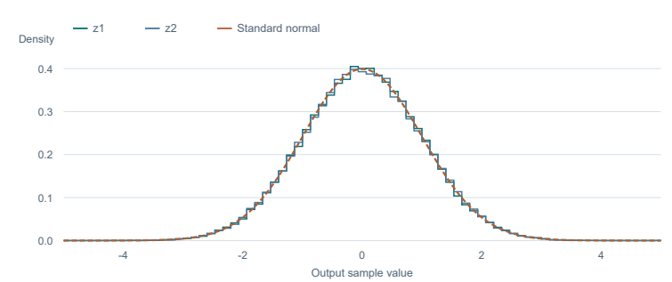

# Fixed-point Gaussian noise generator

**Undergraduate capstone · Verilog · MATLAB · FPGA signal processing**

The core generates two approximately standard-normal samples from two uniform inputs using the Box–Muller transform. I implemented the fixed-point datapath and control logic in Verilog, then used MATLAB to compare the simulated output with the target distribution.

## Architecture

The undergraduate design used LFSR-based uniform inputs. It implemented the sine and cosine with a CORDIC rotator, used lookup tables and linear interpolation for the logarithm and square root, and coordinated the stages with finite-state logic.

The included follow-on implementation targets the Digilent Arty S7-25. This later, AI-assisted build uses a xoshiro128** uniform source, adds deterministic reset checks, and frames each Gaussian pair for UART output. It preserves the Box–Muller, CORDIC, and lookup-table approach. The RTL credits Blackman and Vigna for the PRNG reference. The [board constraints](constraints/arty_s7_25_awgn.xdc) link to Digilent's pin map.

## Verification



| Check | Follow-on result |
| --- | --- |
| Behavioral testbench | 100,000 Gaussian pairs checked against the numerical reference |
| Maximum absolute sample error | 2.63602 × 10⁻⁶ in that test |
| Sample variances | 0.99818 and 1.00239 |
| Reset reproducibility | The first 32 pairs repeat exactly |
| UART RTL simulation | 24 complete packets checked |
| Arty S7-25 post-route timing | 12 MHz constraint met, with +55.164 ns setup slack and +0.048 ns hold slack |
| Post-route utilization | 2,033 LUTs, 1,032 registers, 27 DSPs, and 4 block RAM tiles |

The included behavioral and UART testbenches were rerun successfully in Vivado 2026.1. The resource and timing figures come from the recorded post-route build. Board-level UART measurements for this build are pending.

## Run the included design

Run the commands from this project directory in a Vivado shell. The two `.mem` files in this directory initialize the logarithm and square-root lookup tables.

```text
xvlog -sv rtl/GENERATOR.v rtl/lut_math.v rtl/awgn_s7_25_top.v sim/tb_validation.sv sim/tb_uart.sv
xelab -mt off tb_validation -s awgn_validation
xsim awgn_validation -runall
xelab -mt off tb_uart -s awgn_uart
xsim awgn_uart -runall
```

For synthesis, place and route, and bitstream generation, run `vivado -mode batch -source build_vivado.tcl` from a dedicated checkout. The script rebuilds the local `project/` directory and generates timing and utilization reports.
