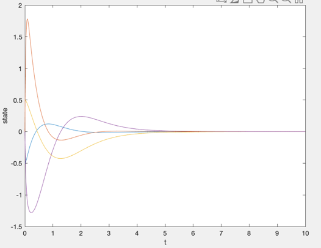
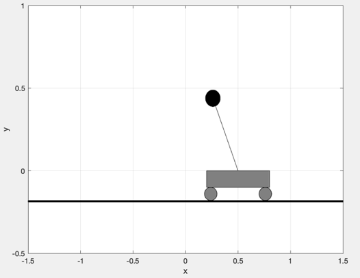

# MATLAB cart-pendulum simulation

**Undergraduate linear systems course · MATLAB · State-space simulation**

I used MATLAB to explore motor and cart-pendulum dynamics, including the response with feedback. I integrated the state equations and used the resulting cart position and pendulum angle to animate the motion.

## Simulation

The cart-pendulum state includes the pendulum angle, angular velocity, cart position, and cart velocity. Plotting the states over time made it possible to inspect the transient response. The animation translated the same state variables into the motion of the cart and the pendulum.

| State trajectories | Animation frame |
| --- | --- |
|  |  |

The figures show results from the course simulation. They document the modeled response and its visualization.
