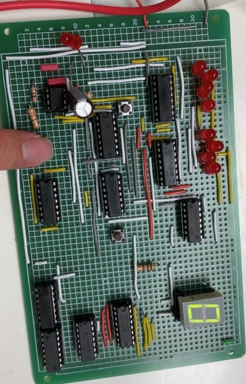
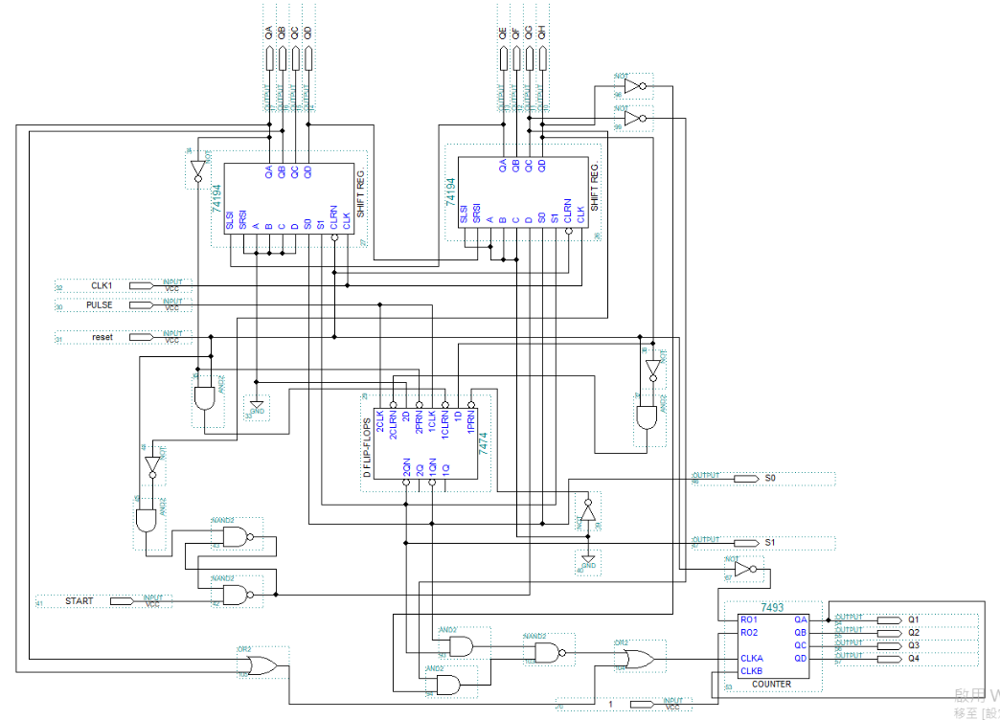
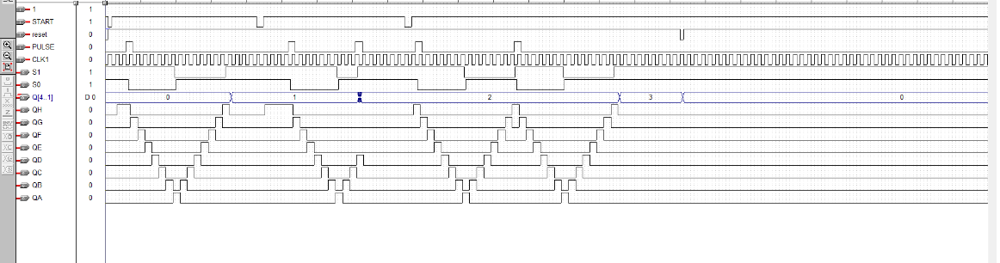

# TTL LED handball game

**Undergraduate digital logic lab · 74LS logic · MAX+PLUS II · Circuit prototyping**

I built a timing game in which an illuminated LED acts as the ball. The player presses a button when the ball returns to the serve end. A missed return ends the round and increments the score displayed on a seven-segment indicator.

## Design and build

A 74LS194 shift register moves the illuminated position. A 74LS74 flip-flop changes the shift direction at the far end, and 74LS00 NAND gates condition the control logic. A counter and decoder drive the missed-return display.

I designed and simulated the circuit in MAX+PLUS II, checked the behavior on a breadboard, and soldered the design onto a prototype board.

| Physical prototype | Original circuit schematic |
| --- | --- |
|  |  |

## Verification

The retained timing trace shows the clock, control inputs, and LED output sequence from the original logic simulation.

