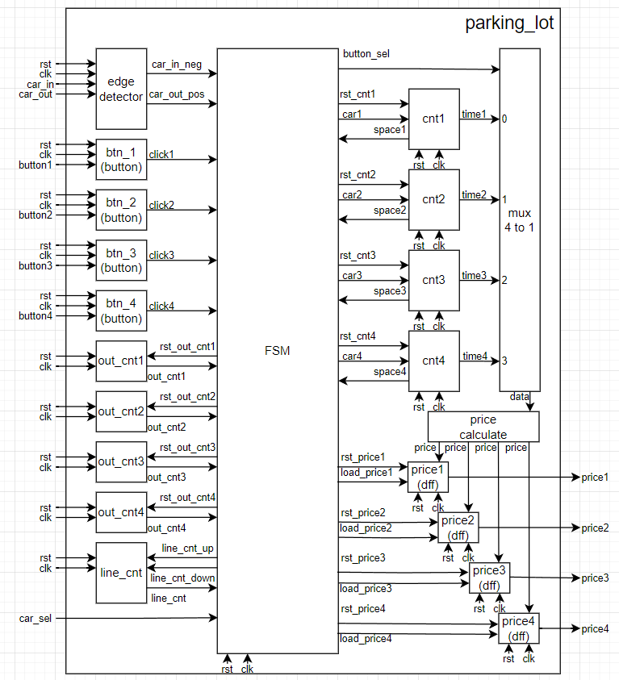
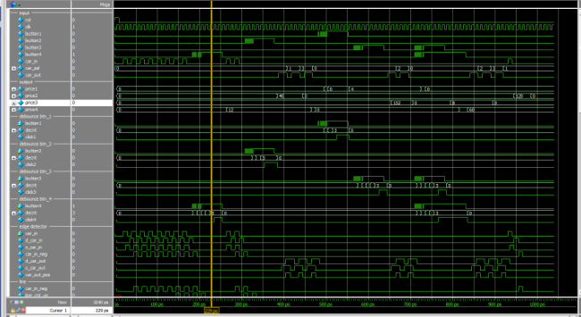

# Verilog parking-lot controller

**Undergraduate course project · Verilog · Finite-state machines · RTL simulation**

I designed a four-space parking-lot controller that allocates spaces, tracks the queue when the lot fills, records parking duration, and calculates fees when cars leave.

## Design

- The falling edge of `car_in` requests the first available space. The queue counter tracks arrivals when all spaces are occupied.
- A timer for each space records how long the car has parked. The rising edge of `car_out` releases a space and selects the time and fee information for that departure.
- Four debounced payment inputs select the payment associated with each space. The state machine coordinates arrival, parking, departure, and payment.

## Verification

I checked vehicle entry, departure, queue changes, fee calculation, and payment triggers with an RTL testbench and waveform inspection. The retained waveform below is an excerpt from that simulation.

This page preserves the design and verification evidence. The complete RTL and testbench files are absent from the available coursework archive.
